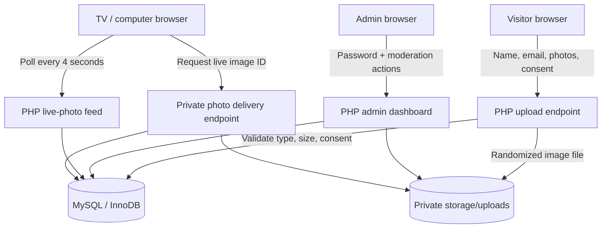
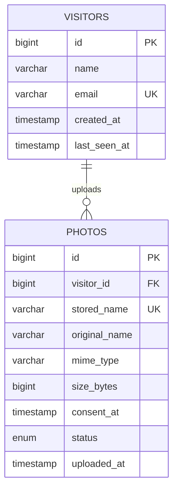

# Architecture

## Stack choice
- **PHP 8.1+**: server-rendered application with no framework or Composer build step.
- **MySQL/MariaDB + PDO MySQL**: relational persistence, unique email identity, InnoDB transactions and safe concurrent visitor upserts.
- **Private local filesystem**: image bytes stay outside the public web root; MySQL stores metadata only.
- **Vanilla JavaScript**: handles visitor upload feedback, slideshow rotation and polling.

## Component diagram

## Data model

- One visitor owns zero or more photos.
- `visitors.email` is unique and normalized to lowercase before storage.
- `photos.status` is `pending`, `approved` or `rejected`; new uploads are inserted as `approved` so they display immediately. Admins can reject/hide or delete photos.
- `consent_at` records the submission consent time.
- Image bytes are not stored in MySQL; only metadata and private storage names are stored.

## Request and data flow
1. `public/index.php` renders the visitor form and CSRF token.
2. `public/upload.php` validates name, email, consent, file count, MIME type and image contents.
3. A MySQL upsert finds or creates the visitor by unique email. `LAST_INSERT_ID(id)` returns the existing ID on duplicate email, preventing duplicate visitor rows during simultaneous first-time submissions.
4. Photo metadata is inserted with `status=approved` in an InnoDB transaction after explicit visitor consent, so it is immediately eligible for the public feed. Uploaded files are moved to random names in `storage/uploads/`; on failure, the transaction is rolled back and files moved by that batch are removed.
5. `public/admin.php` requires an admin session and CSRF token to restore a hidden photo, hide a photo or delete it.
6. `public/feed.php` returns only live/approved photo IDs and display names. The TV slideshow polls every four seconds and rotates images according to `SLIDE_DURATION_MS`.
7. `public/photo.php` serves live/approved images only; `public/admin_photo.php` serves images to authenticated admins.

## Concurrency and failure handling
- InnoDB transactions protect each batch of photo metadata.
- The unique index on `visitors.email` and atomic `INSERT ... ON DUPLICATE KEY UPDATE` avoid a check-then-insert race when two uploads use the same email simultaneously.
- Separate visitor submissions can be handled concurrently by MySQL; PHP upload limits and server capacity still bound throughput.
- If file movement or metadata insertion fails, the transaction is rolled back and files already moved for that batch are removed.

## Security boundaries
- Web document root must be `public/`; project root and `storage/` must not be web-accessible.
- Public image delivery checks that a photo is live/approved; admin image delivery checks an authenticated session. Uploads are auto-published after explicit consent.
- MIME validation uses server-side Fileinfo and actual image decoding.
- Filenames are generated with cryptographically random bytes.
- Forms use session-bound CSRF tokens; database operations use PDO prepared statements.
- Production needs HTTPS, rate limiting, email verification, managed admin identities, backups, monitoring and a retention policy.
